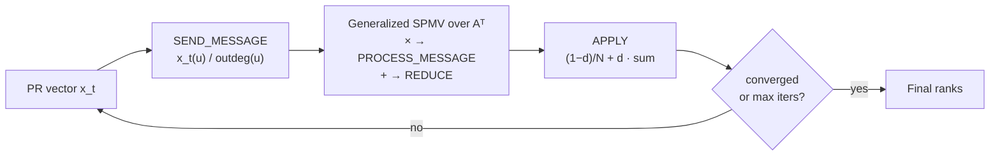

# graphmat-style-pagerank

**From-scratch parallel PageRank as a generalized sparse matrix-vector multiply (SPMV), after [GraphMat](https://arxiv.org/abs/1503.07241) (Sundaram et al., 2015), with OpenMP load balancing, SIMD vectorization, and perf-based profiling.**


> Semester project for **Parallel and Distributed Computing**. Selected paper: *GraphMat: High Performance Graph Analytics Made Productive*.

---

## Why this project

Graph frameworks let you write algorithms in the friendly **"think like a vertex"** style (GraphLab, Giraph), but an independent study (Satish et al.) found them running up to **an order of magnitude slower** than hand-optimized native code on the same hardware.

GraphMat closes that gap. It compiles an ordinary vertex program into a single **generalized SPMV**, so the user gets vertex-programming productivity and the backend gets HPC-grade sparse linear algebra. The paper reports that GraphMat is:

- **4–11×** faster than GraphLab and **2–4×** faster than CombBLAS
- **13–15×** scaling on 24 cores (vs. 8× GraphLab, 2–6× CombBLAS, 6–12× Galois)
- only **~1.2×** slower than hand-optimized native code

This repo re-implements that idea **from first principles** for one algorithm, PageRank. We then measure how much each parallel optimization contributes, on our own code and hardware.

## The core idea: a vertex program becomes an SPMV

Each PageRank iteration is one bulk-synchronous superstep. The SPMV's multiply and add are overloaded by user functions:

| Vertex-program step | SPMV role | PageRank |
|---|---|---|
| `SEND_MESSAGE` | input vector entry | `PR(u) / outdeg(u)` |
| `PROCESS_MESSAGE` | overloaded **×** | message × edge weight |
| `REDUCE` | overloaded **+** | sum |
| `APPLY` | post-SPMV update | `(1 − d)/N + d · sum` |



In matrix form, with damping factor $d$, transposed adjacency matrix $A^\top$, and out-degree diagonal $D$:

$$
\mathbf{x}_{t+1} = \frac{1-d}{N}\,\mathbf{1} + d\,A^{\top} D^{-1}\,\mathbf{x}_t
$$

Iteration stops when $\lVert \mathbf{x}_{t+1} - \mathbf{x}_t \rVert$ (L1 or L∞) falls below a threshold, or when a maximum iteration count is reached.

## What we're building

Each stage is benchmarked before the next one starts, so every optimization's contribution can be measured on its own.

| # | Variant | Technique | What it isolates |
|---|---|---|---|
| 0 | **Serial baseline** | CSR/CSC storage, single-threaded SPMV | Reference for correctness and speedup |
| 1 | **OpenMP static** | `#pragma omp parallel for schedule(static)` | Naive parallelism; exposes load imbalance |
| 2 | **OpenMP dynamic** | P ≫ T matrix partitions + `schedule(dynamic)` | Load-balancing gain on power-law graphs |
| 3 | **SIMD** | `#pragma omp simd`, falling back to AVX2 intrinsics | Vectorization gain of the inner accumulate loop |
| 4 | **Combined** | Dynamic OpenMP + SIMD | End-to-end best configuration |

### Research questions

1. **How large is the load-balancing gap?** The paper describes dynamic over-partitioning qualitatively. We measure static vs. dynamic scheduling directly.
2. **What does SIMD add on its own?** We reproduce the paper's ablation method (its Fig. 7) on our own implementation instead of citing its reported 1.2–1.9×.
3. **Does "fewer instructions, fewer stalls" still explain the speedup?** We profile every variant with hardware counters to check whether that holds for a simpler, non-DCSC implementation or whether a different bottleneck dominates.
4. **Does the scaling trend hold on smaller machines?** The paper reports results on 24 cores. We test on the 4–16 cores we have access to.

## Technical challenges

- **Irregular memory access:** SPMV indexes memory indirectly through index arrays. That defeats naive auto-vectorization and hurts cache locality.
- **Load imbalance:** power-law graphs have a few hub vertices with huge neighbor lists. With static partitioning, one thread grinds through a hub while the others sit idle. The paper attributes a 1.2–2.8× effect to this.
- **Floating-point reduction order:** parallel summation reorders floating-point operations, so correctness is checked within a numerical tolerance rather than bit-for-bit.
- **Vectorizing scattered accumulation:** the SIMD lanes read non-contiguous entries, which requires gather instructions or loop restructuring.

## Evaluation plan

**Correctness:** each parallel variant's converged PageRank vector is compared against the serial baseline and against [NetworkX `pagerank`](https://networkx.org/documentation/stable/reference/algorithms/generated/networkx.algorithms.link_analysis.pagerank_alg.pagerank.html). The pass criterion is an L1 distance below `1e-6`.

**Performance:** wall-clock runtime and speedup (serial ÷ parallel) at 1, 2, 4, 8, … threads, up to the machine's core count.

**Profiling:** `perf stat` measurements of instructions, stall cycles, cache misses, and IPC, in the style of the paper's Fig. 6.

**Datasets** (tentative):

| Dataset | Source | Purpose |
|---|---|---|
| `email-Enron` | [SNAP](https://snap.stanford.edu/data/) | Small real-world graph |
| `soc-LiveJournal1` (sampled) | [SNAP](https://snap.stanford.edu/data/) | Large power-law social graph |
| RMAT (small and large scale) | Graph500 generator | Correctness checks and scaling runs |

Our scaling curves will be shown next to GraphMat's PageRank trend (its Fig. 5a) as a **qualitative** reference only. Absolute runtimes aren't comparable across hardware. What is comparable is whether load balancing and SIMD each contribute a distinct, measurable share of the speedup.

## Roadmap

- [x] Paper analysis and project proposal (Milestone 2)
- [x] Serial baseline: graph loader, CSR/CSC builder, SPMV PageRank
- [x] Correctness harness (serial and NetworkX cross-checks)
- [x] Stage 1: OpenMP static scheduling (implemented and passing tests; benchmarks pending)
- [ ] Stage 2: OpenMP dynamic scheduling with over-partitioning
- [ ] Stage 3: SIMD inner loop
- [ ] Stage 4: combined variant
- [ ] Benchmarks and `perf` profiling across datasets
- [ ] Final report (Milestone 3)

## Scope

**In scope:** PageRank only. It already exercises the full generalized-SPMV pipeline. The work is limited to single-node shared memory, which matches the paper's own evaluation.

**Out of scope:** BFS, SSSP, triangle counting, and collaborative filtering; multi-node/distributed execution; and GPU/OpenCL, which is left as future work.

## Getting started

### Requirements

- Linux (native or WSL2) on an x86-64 CPU with AVX2
- GCC with OpenMP support (C++17), `make`, `curl`
- Python 3 with `venv`, for the NetworkX correctness checks
- Linux `perf`, for the profiling stage only

On Ubuntu/Debian:

```bash
sudo apt install build-essential curl python3 python3-venv
sudo apt install linux-tools-generic   # optional: perf
```

### First-time setup

```bash
git clone <this-repo-url>
cd graphmat-style-pagerank
./setup.sh
```

`setup.sh` is safe to re-run, and finished steps are skipped. It does four things:

1. **Checks the toolchain:** confirms `g++` can build C++17 with OpenMP, and reports AVX2 support, the core count, and whether `perf` hardware counters work.
2. **Creates `.venv/`:** installs NetworkX, NumPy and SciPy from `requirements.txt`.
3. **Downloads `email-Enron`** from SNAP into `data/`.
4. **Builds** every variant into `bin/`.

Add `--large` to also download `soc-LiveJournal1` (~250 MB compressed, ~1 GB unpacked) for the benchmarking runs:

```bash
./setup.sh --large
```

Then activate the Python environment in each new shell:

```bash
source .venv/bin/activate
```

> **WSL2 note:** WSL2 usually doesn't expose the CPU's hardware counters, so `perf stat` won't work there. Timing runs are fine on WSL2. Run the profiling stage on a native Linux machine.

### Build commands

Each `src/<name>.cpp` builds into its own executable `bin/<name>`, with `src/common.h` shared by all of them.

| Command | What it does |
|---|---|
| `make` | Optimized build (`-O3 -march=native -fopenmp`) of every variant into `bin/` |
| `make debug` | AddressSanitizer + UBSan build into `bin/debug/`, for catching memory bugs |
| `make test` | Build, then check every variant against NetworkX and the serial baseline |
| `make data` | Download `email-Enron` into `data/` |
| `make data-large` | Download `soc-LiveJournal1` into `data/` |
| `make clean` | Remove `bin/` |
| `make help` | List these targets |

### Running a variant

```bash
bin/pagerank_static data/email-Enron.txt -t 4 -r 10 -o ranks.txt
```

| Option | Meaning |
|---|---|
| `-o FILE` | write one `vertex rank` line per vertex |
| `-t N` | OpenMP threads (default: `OMP_NUM_THREADS`, else all cores) |
| `-r N` | run N times; report the median time (and the minimum) |
| `-i N` | maximum iterations (default 1000) |
| `-e EPS` | L1 convergence threshold (default 1e-10); `0` runs exactly `-i` iterations |
| `-d D` | damping factor (default 0.85) |
| `-p K` | partitions per thread, K >= 1 (default 8); used by the dynamic variant only |

A run that stops at `-i` without converging is flagged in the output and on stderr.

### Repository layout

```
src/common.h        graph loader + transposed-CSR builder shared by all variants
src/driver.h        shared CLI, timing and output (each variant calls run_variant)
src/sell.h          sliced-ELLPACK layout + builder (SELL-C-sigma) for SIMD variants
src/*.cpp           one PageRank variant per file → bin/<name>
tests/tiny.txt      6-node hand-made graph (hub, cycle, source, dangling node)
tests/edge_cases.txt duplicate edges, self-loop, isolated ids, many dangling nodes
tests/run_tests.sh  correctness harness (run via make test)
tests/check_ranks.py compares a ranks file to NetworkX or to another ranks file
data/               downloaded SNAP graphs (git-ignored)
setup.sh            first-time setup
requirements.txt    Python packages for the correctness checks
```

## References and attribution

```bibtex
@misc{sundaram2015graphmat,
  title  = {GraphMat: High Performance Graph Analytics Made Productive},
  author = {Sundaram, Narayanan and Satish, Nadathur and Patwary, Md Mostofa Ali and
            Dulloor, Subramanya R. and Vadlamudi, Satya Gautam and Das, Dipankar and Dubey, Pradeep},
  year   = {2015},
  eprint = {1503.07241},
  archivePrefix = {arXiv}
}
```

- **Datasets:** [Stanford Large Network Dataset Collection (SNAP)](https://snap.stanford.edu/data/) and the Graph500 RMAT generator, used for benchmarking under their respective licenses.
- **Tools:** OpenMP (GCC/Clang), compiler vectorization reports, Linux `perf`.
- **Original code:** no code from the GraphMat authors' implementation is used. The sparse-matrix format, SPMV kernel, and all parallelization code are written independently from the algorithm description in the paper.
